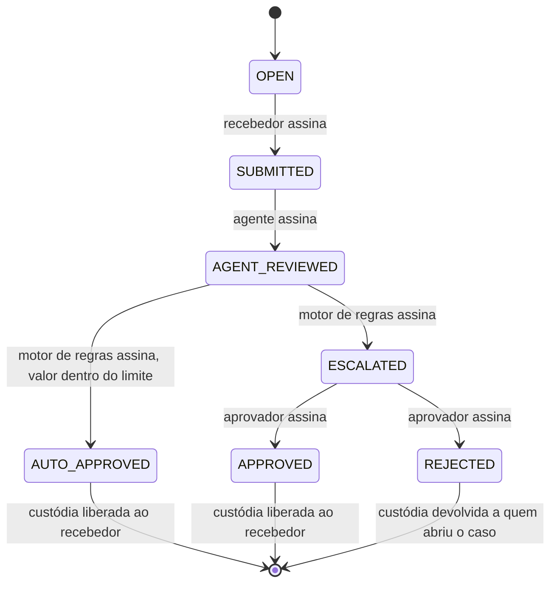
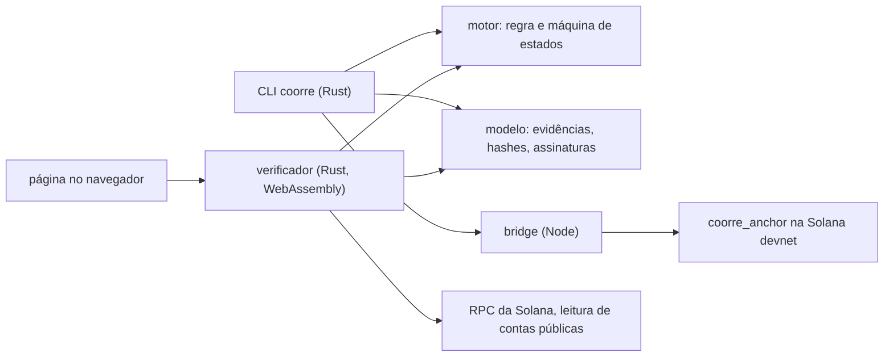
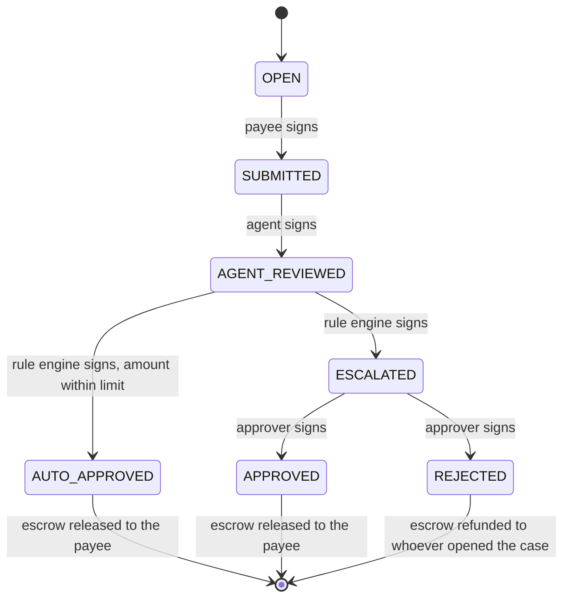
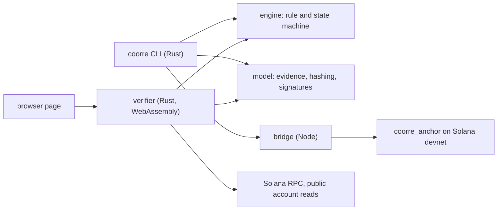

<h1 align="center">
<picture>
<source media="(prefers-color-scheme: dark)" srcset="docs/assets/hero-dark.svg">

</picture>
</h1>

<p align="center">


</p>

<p align="center"><a href="https://catitodev.github.io/CoorRe/"><b>Live verifier</b></a> · <a href="docs/spec/SPEC.md">Specification</a> · <a href="onchain/DEPLOYMENTS.md">Deployments</a> · <a href="docs/evidence/ATTACK_MATRIX.md">Attack matrix</a></p>

<details>
<summary><b>Ler em português (Brasil)</b></summary>

O CoorRe resolve a falta de coordenação verificável. Ele transforma as evidências e as decisões de um processo em prova assinada e ancorada, e entrega um verificador que qualquer pessoa executa, para que a auditoria confira a trilha em vez de reconstruí-la.

O CoorRe on Solana é a aplicação mais exigente do motor: pagamentos liberados por uma regra ou por um agente de IA. O agente age dentro do mandato, a regra decide e uma pessoa assina cada exceção. O programa impõe quem pode agir e o limite de autonomia do agente (`MandateExceeded`); acima do limite, só um aprovador humano libera o pagamento. Qualquer pessoa verifica cada passo sem precisar confiar em nós.

Inscrito no Colosseum Crypto World's Fair, trilha Solana, pelo time watafluxhackteam.

## O problema: coordenação que ninguém consegue verificar

Processos com muitas partes perdem valor na coordenação: quem entrega, quem paga, quem aprova e quem audita. As evidências ficam em e-mails, planilhas e PDFs, as regras ficam com quem decide e as exceções se resolvem por mensagem. Quando alguém precisa conferir o que aconteceu, a trilha tem de ser reconstruída. Numa pesquisa da Swimlane de 2025, 62% dos respondentes disseram que a coleta de evidências de auditoria tem erros ao menos ocasionalmente, e em média só 39% do processo é automatizado ([BetaNews, abril de 2025](https://betanews.com/2025/04/15/less-than-a-third-of-companies-consistently-meet-compliance-standards/)).

Os agentes de IA estão deixando de recomendar para passar a decidir: a Gartner prevê que pelo menos 15% das decisões do trabalho cotidiano serão tomadas de forma autônoma por IA agêntica até 2028, contra 0% em 2024 ([Gartner, junho de 2025](https://www.gartner.com/en/newsroom/press-releases/2025-06-25-gartner-predicts-over-40-percent-of-agentic-ai-projects-will-be-canceled-by-end-of-2027)). A governança não acompanha esse ritmo: 97% dos líderes no mundo e 95% no Brasil planejam adotar IA agêntica em até dois anos, mas só 21% no mundo e 27% no Brasil afirmam ter modelos de governança maduros ([Deloitte, State of AI in the Enterprise 2026](https://www.deloitte.com/br/pt/about/press-room/state-of-ai-2026.html)). E, sem controles, os projetos não avançam: a Gartner também prevê que mais de 40% dos projetos de IA agêntica serão cancelados até o fim de 2027 por custos crescentes, valor de negócio pouco claro ou controles de risco inadequados ([Gartner, junho de 2025](https://www.gartner.com/en/newsroom/press-releases/2025-06-25-gartner-predicts-over-40-percent-of-agentic-ai-projects-will-be-canceled-by-end-of-2027)). Além disso, um limite que vive em configuração pode ser desligado: no estudo de 2026 da ACFE sobre fraude ocupacional, a burla de controles internos existentes foi a principal fragilidade em 19% dos casos, e a ausência de controles internos, em 33% ([ACFE, 2026](https://www.acfe.com/report-to-the-nations)).

### O que precisa ser verdade


Só vale conceder autonomia quando ela pode ser limitada, revertida e auditada. O OWASP Top 10 for Agentic Applications já aponta agentes fora de controle e abuso de identidade e privilégios entre os principais riscos ([OWASP, dezembro de 2025](https://genai.owasp.org/2025/12/09/owasp-top-10-for-agentic-applications-the-benchmark-for-agentic-security-in-the-age-of-autonomous-ai/)). Daí seguem três condições:

- **Limitar o que um agente pode fazer.** O Model AI Governance Framework for Agentic AI, de Singapura, pede às organizações que avaliem e limitem os riscos desde o início, impondo limites ao que os agentes podem fazer, e que pesem cada ação pelo quanto ela é reversível ([IMDA, 2026](https://www.imda.gov.sg/resources/press-releases-factsheets-and-speeches/factsheets/2026/updated-model-ai-governance-framework-for-agentic-ai)).
- **Uma pessoa responde por cada exceção com impacto relevante.** O mesmo framework pede pontos de controle com aprovação humana para ações de alto risco ou irreversíveis, e inclui pagamentos entre elas. O AI Act da União Europeia exige que as pessoas que supervisionam um sistema de alto risco possam decidir não usá-lo, ignorar ou reverter seu resultado e interrompê-lo ([EU AI Act, artigo 14](https://artificialintelligenceact.eu/article/14/)).
- **Toda decisão automatizada pode ser explicada e conferida de novo.** A LGPD garante o direito de solicitar a revisão de decisões tomadas unicamente com base em tratamento automatizado e de receber informações claras sobre os critérios e procedimentos usados ([LGPD, artigo 20](https://www.planalto.gov.br/ccivil_03/_ato2015-2018/2018/lei/l13709.htm)). Em um estudo de campo com 75 iniciativas de IA em 22 empresas brasileiras, a tomada de decisões e o direcionamento das atividades formaram o maior grupo de gargalos, presente em 33% das iniciativas, e o estudo conclui que, quanto mais autonomia os agentes têm, mais precisam de controles, de registro de atividades e de supervisão humana; os autores afirmam que a amostra não é estatisticamente representativa ([StartSe Consulting, segundo a Mundo RH, outubro de 2026](https://mundorh.com.br/ia-nas-empresas-84-dos-projetos-analisados-apresentam-resultados-e-revelam-novos-desafios-para-o-rh/)).

## O que é o CoorRe

O CoorRe é um motor de verificabilidade para processos em que várias partes precisam concordar sobre o que aconteceu e sobre quem decidiu. Ele foi feito para as organizações que conduzem esses processos e para quem as audita.

A prova mostra três coisas: que um documento não mudou um único byte, que uma chave específica o assinou e que a decisão seguiu a regra que ela nomeia. Se o conteúdo do documento é verdadeiro depende de quem o emitiu; por isso o emissor assina.

Começamos pelo processo: suas regras, seus papéis e os pontos em que algo precisa ser verificado. A tecnologia vem desses pontos.

## Como funciona

| Papel | Quem | O que pode fazer |
|---|---|---|
| Recebedor | O fornecedor, prestador ou beneficiário a quem o pagamento é devido | Envia a evidência. Recebe o pagamento quando a decisão está provada. |
| Agente de IA | Um agente de pré-análise | Lê a evidência e recomenda. Não aprova nada nem movimenta fundos. |
| Motor de regras | Um sistema determinístico | Aplica a regra indicada na evidência e decide dentro do mandato. |
| Aprovador humano | Uma pessoa designada, com autoridade | Assina cada exceção, aprovando ou rejeitando com justificativa. |

1. **A evidência entra assinada.** Cada documento é identificado pelo hash dos seus bytes exatos, e quem o envia assina uma W3C Verifiable Credential, o modelo de dados publicado como padrão W3C em maio de 2025 ([W3C, maio de 2025](https://lists.w3.org/Archives/Public/w3c-news/2025AprJun/0000.html)).
2. **O agente recomenda.** Ele registra sua recomendação, assinada com a própria chave.
3. **A regra decide dentro do mandato.** Uma regra determinística, identificada pelo próprio hash, aprova o que está dentro do limite e escala o resto, com um motivo para cada condição não atendida.
4. **Uma pessoa assina a exceção.** Acima do limite, só o aprovador pode aprovar ou rejeitar.
5. **Cada passo é ancorado, e qualquer pessoa confere.** O verificador roda sete checagens e executa a regra de novo sobre os documentos.

Os documentos ficam fora da cadeia; só hashes, chaves públicas, estados e valores são ancorados. O núcleo é escrito em Rust e não depende da Solana; a Solana é a âncora desta versão.

## CoorRe on Solana

Um pagamento liberado por uma regra ou por um agente de IA é o caso mais difícil para o motor, porque o dinheiro se move com a decisão. Na Solana devnet, o programa `coorre_anchor` guarda cada pagamento em custódia e impõe:

- a máquina de estados do caso e a chave de papel autorizada em cada passo, com quatro chaves distintas por caso;
- o limite de autonomia: uma aprovação acima dele falha com `MandateExceeded`, e só a chave do aprovador libera um caso escalado;
- a cadeia de hashes: cada passo precisa apontar para o hash do anterior;
- o desfecho: a custódia vai para o recebedor quando a decisão está provada e ancorada, e volta para quem abriu o caso quando ele é rejeitado.

Um limite guardado num banco de dados ou numa API pode ser alterado por quem os opera. Aqui o programa recusa a aprovação, então nenhum servidor ou agente consegue aprovar acima do mandato. Mudar isso exigiria uma atualização do programa; hoje a autoridade de atualização é uma carteira única, e levá-la para uma multisig está no roadmap.

O dinheiro no CoorRe é sempre um pagamento devido por uma entrega ou por uma decisão. Não há trading, precificação, ordens, mercados nem especulação. O pagamento é a consequência; o produto é a decisão provada.

### Onde o CoorRe se encaixa nos trilhos de pagamento de agentes

Os trilhos de pagamento para agentes já existem. O Agent Payments Protocol (AP2), do Google, usa Mandates assinados criptograficamente, apoiados em credenciais verificáveis, como prova do que o usuário autorizou, inclusive limites de preço ([Google Cloud, setembro de 2025](https://cloud.google.com/blog/products/ai-machine-learning/announcing-agents-to-payments-ap2-protocol/?hl=en)). O x402 é um protocolo aberto de pagamentos que suporta a Solana mainnet e a devnet ([x402](https://docs.x402.org/faq)). Os Solana Payment Channels permitem que um agente deposite um teto de gastos em custódia on-chain e autorize cada requisição com uma mensagem assinada, em vez de uma transação ([Solana](https://solana.com/payment-channels)).

Esses trilhos respondem como um agente paga. Eles não provam que um pagamento que exigia julgamento foi decidido sob a regra certa, com a evidência certa, por alguém com autoridade para decidir. Essa é a camada que o CoorRe acrescenta. Ele complementa os trilhos: a decisão comprovada é o que um trilho pode executar.

## Um caso, de ponta a ponta

SUP-002 é o pagamento de 0,20 SOL a um fornecedor, em que a automação pode aprovar até 0,10 SOL. A licença ambiental do fornecedor está vencida. Esta é a sequência que rodou na Solana devnet, com dados sintéticos.

<p align="center">
<picture>
<source media="(prefers-color-scheme: dark)" srcset="docs/assets/flow-sup002-dark.svg">

</picture>
</p>

## Verifique você mesmo

Cada etapa é uma credencial assinada cujo hash está ancorado na Solana. O verificador recebe um pacote com essas credenciais e os documentos originais, lê as contas na cadeia e executa sete checagens. Ele roda na linha de comando e no navegador, a partir do mesmo código Rust.

<p align="center">
<picture>
<source media="(prefers-color-scheme: dark)" srcset="docs/assets/verify-checks-dark.svg">

</picture>
</p>

| Checagem | O que comprova |
|---|---|
| 1. Digests dos artefatos | Cada arquivo corresponde ao hash que sua evidência declara. |
| 2. Hashes das evidências | Cada credencial gera exatamente o hash que foi ancorado. |
| 3. Assinaturas | Cada credencial traz uma prova Ed25519 válida (W3C eddsa-jcs-2022). |
| 4. Vínculo do signatário | A chave que assinou é a chave do papel registrada on-chain para aquela etapa. |
| 5. Cadeia de hashes | As etapas formam uma cadeia contínua do caso até seu estado final. |
| 6. Correspondência on-chain | As contas pertencem ao programa CoorRe e guardam exatamente os valores recalculados. |
| 7. Decisões reproduzidas | O verificador executa de novo a regra indicada na evidência, a partir do registro que ele traz, sobre os documentos enviados, e chega à decisão registrada. |

A checagem 7 fecha uma lacuna que a cadeia não consegue fechar: o programa impõe o valor contra o mandato, mas não lê documentos. Se um motor de regras comprometido aprovasse um caso com a licença vencida, as checagens 1 a 6 continuariam passando e a 7 falharia. O verificador só executa as regras que traz consigo: uma decisão que indique qualquer outra regra, versão ou hash falha na checagem 7. Veja a [ADR-004](docs/decisions/ADR-004-reproducible-automated-decisions.md) e a [ADR-005](docs/decisions/ADR-005-rule-registry-and-application-domains.md).

## Modos de verificação

| Modo | Status | Quem verifica | O que vê |
|---|---|---|---|
| Público | Disponível | Qualquer pessoa, no navegador ou na linha de comando, sem login | Quem tem o pacote de auditoria: documentos, passos assinados, chaves de papel, âncoras e as sete checagens |
| Permissionado | Roadmap | Cada parte, conforme o papel | Só o que o papel exige, por visões por papel e chaves de visualização |

O modo público é o deste repositório e do verificador ao vivo. A cadeia guarda só hashes, chaves públicas, estados e valores; as credenciais e os documentos viajam no pacote de auditoria. O modo permissionado não está construído.

## O mesmo motor, cinco domínios

O programa, os papéis, a máquina de estados e o modelo de evidências são os mesmos em todos os domínios. Só a regra muda, e cada regra vem no registro do verificador com casos de demonstração sintéticos: um que passa e um que precisa do aprovador.

| Domínio | Quem age | Evidência | Regra | Autoridade humana | Por que importa | Status |
|---|---|---|---|---|---|---|
| Homologação e pagamento de fornecedores | Fornecedor, agente de compras, motor de regras | Certidão fiscal, licença ambiental | supplier-docs v1 | Gestor de compras | [StartSe Consulting, 2026](https://mundorh.com.br/ia-nas-empresas-84-dos-projetos-analisados-apresentam-resultados-e-revelam-novos-desafios-para-o-rh/) | roda na devnet |
| Pagamentos por marco em projetos financiados, com prestação de contas | Organização beneficiária, agente de análise, motor de regras | Termo de fomento, relatório do marco, prestação de contas | milestone-payment v1 | Gestor do fundo | [Lei 13.019/2014, art. 48](https://www.planalto.gov.br/ccivil_03/_ato2011-2014/2014/lei/l13019compilado.htm) | roda na devnet |
| Pagamentos por serviços ambientais com evidência de monitoramento | Provedor no território, agente de monitoramento, motor de regras | Contrato, relatório de monitoramento | ecosystem-services-payment v1 | Gestor do programa | [Lei 14.119/2021, art. 6º, § 6º](https://www.planalto.gov.br/ccivil_03/_ato2019-2022/2021/lei/l14119.htm) | roda na devnet |
| Contratos de serviço entregues por consultorias | Consultoria, agente de análise, motor de regras | Contrato de serviço, termo de aceite, nota fiscal | service-delivery v1 | Gestor do contrato | [Lei 4.320/1964, arts. 62 e 63](https://www.planalto.gov.br/ccivil_03/leis/l4320.htm), quando o contratante é um órgão público | roda na devnet |
| Compras preparadas por agentes de IA | Fornecedor, agente de compras, motor de regras | Pedido de compra, cotação do fornecedor, cadastro do fornecedor | agent-purchase v1 | Gestor de compras | [AP2](https://cloud.google.com/blog/products/ai-machine-learning/announcing-agents-to-payments-ap2-protocol/?hl=en), [IMDA](https://www.imda.gov.sg/resources/press-releases-factsheets-and-speeches/factsheets/2026/updated-model-ai-governance-framework-for-agentic-ai), [StartSe Consulting](https://mundorh.com.br/ia-nas-empresas-84-dos-projetos-analisados-apresentam-resultados-e-revelam-novos-desafios-para-o-rh/) | roda na devnet |

Os pagamentos por serviços ambientais são onde o motor nasceu.

## Evidências e limites

- **Matriz de ataques.** Doze ataques aos dez casos gravados rodam como testes automatizados a cada `cargo test`, cada um com as checagens que o barraram. A matriz também lista cinco lacunas que o motor não fecha hoje: documento de origem falso, chave de papel roubada, conluio entre quem abre o caso e o aprovador, qualidade da decisão humana e confiança num snapshot offline. Veja [docs/evidence/ATTACK_MATRIX.md](docs/evidence/ATTACK_MATRIX.md).
- **Snapshot da devnet.** A devnet pode ser reiniciada. [docs/evidence/devnet-snapshot](docs/evidence/devnet-snapshot/README.md) guarda as 45 contas do programa e os 45 status de transação dos dez casos. Com ele, os dez casos verificam 7 de 7 na linha de comando sem acesso à rede, e o verificador ao vivo pode ler as mesmas contas gravadas em vez da rede.
- **Registro de construção.** [docs/evidence/EVIDENCE_LOG.md](docs/evidence/EVIDENCE_LOG.md) registra cada etapa com data.

O modelo de ameaças, os controles e a revisão de dependências estão em [docs/SECURITY.md](docs/SECURITY.md). Os pontos principais:

- O programa impõe o mandato, então nenhum servidor ou agente consegue aprovar acima dele; a autoridade de atualização é o ponto único de controle que resta.
- As regras são determinísticas, e o verificador só executa as regras que traz: uma decisão que cite outra regra, versão ou hash falha na checagem 7.
- O verificador nunca toma o programa esperado do pacote que está verificando.
- O conteúdo do pacote não é confiável: o verificador no navegador o exibe só como texto, sob uma política de segurança de conteúdo estrita.
- A bridge e a CLI recusam qualquer rede que não seja a devnet e recusam arquivos de chave que outros usuários possam ler.

Limites declarados desta versão:

- Só devnet; a mainnet é um próximo passo, depois de recursos e de uma auditoria. As chaves de demonstração são operadas pela equipe do CoorRe.
- O agente de IA é simulado e determinístico. Nenhum modelo de linguagem é chamado.
- Todos os documentos dos domínios são sintéticos. A checagem 7 prova que uma decisão segue a regra, não que um documento é autêntico.
- Sem build verificável e sem fuzzing. O RPC público da devnet limita requisições.
- A autoridade de atualização do programa é uma carteira única; levá-la para uma multisig Squads está no roadmap.

## Experimente

O caminho mais rápido: abra o [verificador ao vivo](https://catitodev.github.io/CoorRe/) e clique em um caso gravado. Tudo é conferido no seu navegador; só endereços de contas públicas são enviados a um RPC da Solana.

Pela linha de comando, você precisa de Rust (stable) e Node 20 ou mais recente. Estes comandos verificam um caso gravado na devnet contra a cadeia ao vivo. Não precisam de chaves nem de SOL.

```bash
git clone https://github.com/catitodev/CoorRe.git
cd CoorRe
npm ci --prefix bridge
cargo build --release --manifest-path offchain/Cargo.toml -p coorre-cli
offchain/target/release/coorre verify \
  --bundle web/verifier/samples/SUP-002/bundle.json \
  --artifacts web/verifier/samples/SUP-002/artifacts
```

O comando mostra as sete checagens e termina com status 1 se alguma falhar. Altere um byte de um arquivo da pasta artifacts e rode de novo para ver as checagens 1 e 7 falharem. O mesmo comando verifica as amostras AGT-002 e PES-002, gravadas na devnet sob agent-purchase v1 e ecosystem-services-payment v1.

Os outros quatro domínios também rodam offline, sem chaves e sem rede. Este teste passa os oito casos pelo simulador em memória, verifica cada um com 7/7 e confere que um byte alterado em qualquer documento faz as checagens 1 e 7 falharem:

```bash
cargo test --manifest-path offchain/Cargo.toml -p coorre-cli --test domains_offline
```

<details>
<summary>Rodar os testes e a demonstração</summary>

```bash
cargo test --manifest-path offchain/Cargo.toml --workspace
npm test --prefix bridge
npm test --prefix web/verifier
```

Os testes de `web/verifier` precisam antes do build em WebAssembly: `WASM_BINDGEN=/path/to/wasm-bindgen scripts/build-verifier`.

A demonstração narrada abre casos reais na devnet. Ela precisa de cinco arquivos de chave Solana em `.local/keys` (creator, submitter, agent, rule_engine, approver) com modo 600 e de algum SOL de devnet na chave creator:

```bash
offchain/target/release/coorre demo run
```

Com os mesmos arquivos de chave, qualquer caso roda narrado e offline, sem enviar nada a uma rede:

```bash
offchain/target/release/coorre demo run --offline --case AGT-002 --case MIL-002
```

</details>

## Por dentro

<details>
<summary>Máquina de estados imposta pelo programa</summary>



Cada transição precisa ser assinada pela chave do papel responsável por ela. As quatro chaves de papel de um caso precisam ser distintas.

</details>

<details>
<summary>Registro de regras</summary>

Cada regra é um documento JSON em [offchain/crates/coorre-engine/rules](offchain/crates/coorre-engine/rules), compilado no motor e no verificador e identificado pelo SHA-256 da sua forma canônica. Uma regra só aprova quando todas as condições são atendidas; caso contrário, escala com um motivo para cada condição não atendida, na ordem em que a regra as lista, e a checagem do mandato vem sempre por último.

| Regra | Documentos | Casos de demonstração |
|---|---|---|
| supplier-docs v1 | certidão fiscal, licença ambiental | SUP-001, SUP-002, SUP-003 |
| agent-purchase v1 | pedido de compra, cotação do fornecedor, cadastro do fornecedor | AGT-001, AGT-002 |
| ecosystem-services-payment v1 | contrato, relatório de monitoramento | PES-001, PES-002 |
| milestone-payment v1 | termo de fomento, relatório do marco, prestação de contas | MIL-001, MIL-002 |
| service-delivery v1 | contrato de serviço, termo de aceite, nota fiscal | SRV-001, SRV-002 |

Os casos e seus documentos sintéticos estão descritos em [demo/fixtures](demo/fixtures/README.md).

</details>

<details>
<summary>Arquitetura</summary>



O núcleo em Rust não depende da Solana. A bridge em Node é o único componente que envia transações, e ela recusa qualquer rede que não seja a devnet. As evidências ficam fora da cadeia; só hashes e chaves públicas chegam a ela.

</details>

## Prova on-chain

O programa está implantado na Solana devnet:

- Programa: [`9esN1A8K1SASLg17ob81dbSdB4VX8ozc6tBLmJ247Wv`](https://explorer.solana.com/address/9esN1A8K1SASLg17ob81dbSdB4VX8ozc6tBLmJ247Wv?cluster=devnet)
- Transação de implantação: [`2ku5UxeT…`](https://explorer.solana.com/tx/2ku5UxeTyM1qrVcKhB3s68pDVh2cZyyTpFXuhF8orWjzvswoCguiN5AjoLAAvbxLbG6yRBDHvxgAFYKzcsq7JJxY?cluster=devnet)

<details>
<summary>Transações do caso SUP-002</summary>

| Etapa | Transação |
|---|---|
| OPEN, 0,20 SOL em custódia | [`rBt7urt2…`](https://explorer.solana.com/tx/rBt7urt2sexKvv4kYWKfXCam54wxJsq46Zjs8hiV1HL2rWt8VJMMQKW8BB4HGxiMbirGzofe4CzHLbLh5GhascB?cluster=devnet) |
| SUBMITTED | [`3eduiGPv…`](https://explorer.solana.com/tx/3eduiGPv3z2KbVNicNovUKYcvJn5UYMEhhhRcwsNB7g9D8bDNpWgT8JPy2sbqmZwK4ujEaGuX4WmkM577JUEy8LN?cluster=devnet) |
| AGENT_REVIEWED | [`4tb5Us6g…`](https://explorer.solana.com/tx/4tb5Us6gM4dMkyHrFSVLBXWDme5ATisEW5QADx5NRibGeZb4fMg5HG6exgX4cyCpNADV6JAUVrPzZLUo4YwzpxZi?cluster=devnet) |
| AUTO_APPROVED tentado acima do limite | Recusado pelo programa com `MandateExceeded`. Nenhuma transação existe. |
| ESCALATED | [`3zQBE5sY…`](https://explorer.solana.com/tx/3zQBE5sYP5GyqazDYLh445kPeCWmWDBewRHFYsNjJKWye8Q28nFDeMnL4whmmWzmDTPwfZqXxgbZAdg3ZySmNQd2?cluster=devnet) |
| APPROVED, custódia liberada | [`2nQ2pHJ7…`](https://explorer.solana.com/tx/2nQ2pHJ7ACi6LQeNSzDAhM2N2ji9kkAZEmgsfTghSNNToQizXVXwkZiR3Ejiz2jwmiz8FUZMR3hG6RUDW1aapfYc?cluster=devnet) |

Mais detalhes da implantação e o caso SUP-001 estão em [onchain/DEPLOYMENTS.md](onchain/DEPLOYMENTS.md).

</details>

<details>
<summary>Casos dos outros quatro domínios (devnet, 2026-10-10)</summary>

| Caso | Regra | Registro do caso | Etapa final |
|---|---|---|---|
| AGT-001 | agent-purchase v1 | [`HFkXBQAZ…`](https://explorer.solana.com/address/HFkXBQAZsR5fv9ydjUHGhSzjcbxi4qFNAdz3tVoguVDV?cluster=devnet) | AUTO_APPROVED, custódia liberada: [`3rTeiVAQ…`](https://explorer.solana.com/tx/3rTeiVAQN8MbEKrGJ5E9f1zbhd2tRLHqG35uDuGkLmcZAMTWpK5WfczpfpxysZ4htvevSN1qksPac3QYmkVvJFkY?cluster=devnet) |
| AGT-002 | agent-purchase v1 | [`4tkhyE96…`](https://explorer.solana.com/address/4tkhyE96rDPd3hCZvxge8i5sYNGmkH4SAsdK5SgJFeQz?cluster=devnet) | APPROVED, custódia liberada: [`NmdtA5YR…`](https://explorer.solana.com/tx/NmdtA5YRW1nBTmiBqEQJSpitnMQyQLpUZXSGNUTFJ6fSQR9WTXtkrEM54drMT3tavcFvxV221SFpPN9icqGvBmn?cluster=devnet) |
| PES-001 | ecosystem-services-payment v1 | [`6VKegWgg…`](https://explorer.solana.com/address/6VKegWgguGwfoqpSkgWYCViqPjsvwqv5uX4vRFbVRGsT?cluster=devnet) | AUTO_APPROVED, custódia liberada: [`3uzkLCcM…`](https://explorer.solana.com/tx/3uzkLCcMmUUUkbPT3fGwmYHAr9vyxjG3zh3URbw1bP7iF6AM3WN56ePcJVUv7cdrHvAGZ3hu1DSHWg9eRVwm8LSY?cluster=devnet) |
| PES-002 | ecosystem-services-payment v1 | [`Fg7PbduC…`](https://explorer.solana.com/address/Fg7PbduC8r5KWM8WkRxqsDXfyHoqkBjM9HCaCe8csAF1?cluster=devnet) | APPROVED, custódia liberada: [`5WrgY3n5…`](https://explorer.solana.com/tx/5WrgY3n5ViURcBRiwV1jQvBkj2NPDevy4p6SVWyr8kVUQwMmi819yxQXAUYFxaw1jcemKRPTJrQwLPvdGLsurPLx?cluster=devnet) |
| MIL-001 | milestone-payment v1 | [`EJutNMDd…`](https://explorer.solana.com/address/EJutNMDdpkjw72S5mMbXqgkuwjjF9y7jNYgUaicLLbFJ?cluster=devnet) | AUTO_APPROVED, custódia liberada: [`5TMsTFEN…`](https://explorer.solana.com/tx/5TMsTFENPinNkwqeGLP6DPQJgAEyo2JNXgDxGQSoKTb7SPuvxGdJSsqwdQj64B1ekgXoWVnwV53EisF5FuJScEt3?cluster=devnet) |
| MIL-002 | milestone-payment v1 | [`G46pdzcf…`](https://explorer.solana.com/address/G46pdzcfhWgSJhiNvV36sxGussmWJ7kwaoRd3QDFpmRL?cluster=devnet) | REJECTED, custódia devolvida: [`5rW4veHJ…`](https://explorer.solana.com/tx/5rW4veHJEtHiDHsQJphtp8TtvUpSyLYBMLAGBbDCbyZYLXQVUwc91fjqsqi9yNUKa4G4MAC9BodBi1PS2Gd6vrDF?cluster=devnet) |
| SRV-001 | service-delivery v1 | [`CzWgCr1H…`](https://explorer.solana.com/address/CzWgCr1HtwrHzC1Wwy4CGmkDeC6CaDrtWykrWhct9zSb?cluster=devnet) | AUTO_APPROVED, custódia liberada: [`2JMRXjZ6…`](https://explorer.solana.com/tx/2JMRXjZ6sRHqCKJN5p4nMAxnyESL8tgLLRqiEyQ8WJPQkaB3HaDs33TFE1DkQVqFvSU6jXosQLWDebV98YRySeAb?cluster=devnet) |
| SRV-002 | service-delivery v1 | [`DNPDxAje…`](https://explorer.solana.com/address/DNPDxAjex72NgF9xKRZdLzvywMtmBUWDU2wcTZhGzSLm?cluster=devnet) | REJECTED, custódia devolvida: [`3FV3ThfP…`](https://explorer.solana.com/tx/3FV3ThfPDWuvyND9LfF8kr1XJaWFPTbgmCr2jMthh28U9NJBfek3M8TGheLK3G7pLzcizEoKfQcrCLzMnhg9Wpa4?cluster=devnet) |

AGT-002 e PES-002 também mostram o programa recusando uma aprovação acima do mandato com `MandateExceeded` antes de o caso ser escalado. Todas as etapas e os saldos estão em [onchain/DEPLOYMENTS.md](onchain/DEPLOYMENTS.md). Os pacotes de auditoria dos oito casos estão no repositório, prontos para o `coorre verify`: AGT-002 e PES-002 em [web/verifier/samples](web/verifier/samples), os outros seis em [onchain/devnet-bundles](onchain/devnet-bundles/README.md).

</details>

## Modelo de negócio

A camada de verificação deste repositório (programa on-chain, modelo de evidências, verificador e bridge) é open source sob a licença Apache-2.0, para que qualquer pessoa possa confiar nela e compô-la. Uma plataforma comercial sobre ela, com orquestração de casos, autoria de regras, pacotes de regras por domínio, integrações e serviço hospedado, é o próximo passo.

## Roadmap

- Autoridade de atualização sob uma multisig Squads.
- Documentos assinados por um emissor ou registro real.
- Verificação permissionada: visões por papel e chaves de visualização, para que cada parte veja só o que o seu papel exige.
- Ancoragem por um log assinado, para organizações que não podem usar uma rede pública.
- Ancoragem em lote por raízes de Merkle.
- Solana Actions e Blinks para as decisões do aprovador.
- Pagamentos no estilo x402 para agentes.
- Integração com trilhos de pagamento de agentes (AP2, x402, Solana Payment Channels) como camada de decisão.
- Privacidade de pagamento (remetente, destinatário, valor) numa rede privada como a Zcash, com a trilha de evidências pública ([notas de desenho](docs/design/ZCASH_READINESS.md)).
- Mainnet, depois de uma auditoria externa.

## Sinal de mercado

A Gartner prevê que, até 2030, as tecnologias de guardian agents, criadas para supervisionar o que os agentes de IA fazem, responderão por pelo menos 10 a 15% dos mercados de IA agêntica ([Gartner, junho de 2025](https://www.gartner.com/en/newsroom/press-releases/2025-06-11-gartner-predicts-that-guardian-agents-will-capture-10-15-percent-of-the-agentic-ai-market-by-2030)). Ela também espera que os gastos com governança de IA cheguem a US$ 492 milhões em 2026 e passem de US$ 1 bilhão até 2030 ([Gartner, fevereiro de 2026](https://www.gartner.com/en/newsroom/press-releases/2026-02-17-gartner-global-ai-regulations-fuel-billion-dollar-market-for-ai-governance-platforms)).

## Perguntas frequentes

<details>
<summary>O CoorRe é um protocolo de trading ou de DeFi?</summary>

Não. No CoorRe, o dinheiro é sempre um pagamento devido por uma entrega ou por uma decisão: fica em custódia quando o caso é aberto, é liberado ao recebedor quando a decisão é comprovada e ancorada, e volta para quem abriu o caso quando a decisão é uma rejeição. O CoorRe não negocia, não precifica, não recebe ordens, não opera mercados nem especula.

</details>

<details>
<summary>Por que on-chain?</summary>

Porque o limite não deve depender de quem opera o servidor. O programa recusa uma aprovação acima do mandato, algo que um banco de dados ou uma API não conseguem impor contra quem os opera. Hoje o operador ainda poderia atualizar o programa, porque a autoridade de atualização é uma carteira única; levá-la para uma multisig está no roadmap. A cadeia também dá a cada passo um registro público com carimbo de tempo. Na devnet esse registro pode ser reiniciado, e por isso as contas gravadas ficam em docs/evidence/devnet-snapshot.

</details>

<details>
<summary>Por que Solana?</summary>

Porque o limite precisa ser imposto onde o dinheiro está guardado, a um custo que permite que cada passo de um caso seja uma transação própria. Nos oito casos de domínio gravados na devnet em 2026-10-10, as taxas de rede somaram 320.000 lamports (0,00032 SOL); a maior parte do custo é o aluguel (rent) que mantém on-chain cada registro de caso e cada âncora de evidência (60.472.320 lamports para oito registros de caso e 28 âncoras), conforme [onchain/DEPLOYMENTS.md](onchain/DEPLOYMENTS.md). Trilhos de pagamento de agentes como o x402 e os Solana Payment Channels já rodam na Solana, então a decisão comprovada fica ao lado do trilho que age sobre ela.

</details>

<details>
<summary>O CoorRe precisa de blockchain?</summary>

O núcleo não precisa: o modelo de evidências, as regras e o verificador são escritos em Rust, sem dependência da Solana. A cadeia é a âncora e, nos pagamentos, o lugar onde o limite é imposto. A ancoragem por um log assinado, para organizações que não podem usar uma rede pública, está no roadmap.

</details>

<details>
<summary>O CoorRe prova que um documento é verdadeiro?</summary>

Ele prova que o documento não mudou, qual chave o assinou e que a decisão seguiu a regra. Se o conteúdo é verdadeiro depende de quem o emitiu. Nesta versão, todos os documentos são sintéticos, e a credencial que leva cada um é assinada pela parte que o envia; documentos assinados por um emissor ou registro real estão no roadmap.

</details>

<details>
<summary>O que o CoorRe ainda não consegue impedir?</summary>

A [matriz de ataques](docs/evidence/ATTACK_MATRIX.md) lista cinco lacunas, cada uma com o que a fecharia: documento de origem falso, chave de papel roubada, conluio entre quem abre o caso e o aprovador, qualidade da decisão humana e confiança num snapshot offline.

</details>

<details>
<summary>E se a devnet for reiniciada?</summary>

Os dez casos continuam verificáveis. [docs/evidence/devnet-snapshot](docs/evidence/devnet-snapshot/README.md) guarda as 45 contas do programa e os 45 status de transação, e o `coorre verify --accounts` os lê sem nenhuma chamada de rede. O snapshot é uma gravação feita pela equipe; suas assinaturas de transação e slots permitem que qualquer pessoa o confira contra a devnet enquanto ela existir, ou contra um arquivo dela.

</details>

<details>
<summary>Quem vê os dados?</summary>

No modo público, quem tem o pacote de auditoria. A cadeia guarda só hashes, chaves públicas, estados e valores; os documentos e as credenciais viajam no pacote e nunca vão para a cadeia. Um modo permissionado, em que cada parte vê só o que o seu papel exige, e a privacidade de pagamento numa rede privada como a Zcash estão no roadmap.

</details>

<details>
<summary>O que o agente de IA faz, na prática?</summary>

Ele lê os documentos enviados e registra uma recomendação: escalar ou aprovar automaticamente. Ele não pode aprovar nem liberar nada. Nesta versão, ele é simulado e determinístico: executa a mesma regra do motor de regras e nenhum modelo de linguagem é chamado. Um agente real pode substituí-lo depois; a checagem 7 compara a recomendação dele com a regra, e essa recomendação continua sem mover fundos.

</details>

<details>
<summary>Como se acrescenta um novo processo?</summary>

Escrevendo a regra dele. Cada regra é um documento JSON compilado no motor e no verificador e identificado pelo SHA-256 da sua forma canônica. Nesta versão, os cinco domínios rodam sobre o mesmo programa implantado; o que cada um acrescenta é sua regra, seus documentos e seus casos de demonstração.

</details>

<details>
<summary>Posso verificar sem rodar nada?</summary>

Sim. Abra o [verificador ao vivo](https://catitodev.github.io/CoorRe/), clique em um dos quatro casos gravados ou arraste seu próprio pacote e documentos. As checagens rodam no seu navegador, a partir do mesmo código Rust da linha de comando, compilado para WebAssembly. A página também pode ler as contas do snapshot gravado da devnet em vez da rede, e está disponível em inglês e em português.

</details>

<details>
<summary>Qual a diferença em relação a AP2, x402 ou Solana Payment Channels?</summary>

Eles movem o dinheiro e provam o que um usuário autorizou um agente a gastar. O CoorRe prova a decisão por trás de um pagamento que exige julgamento: qual regra se aplicou, a qual evidência e quem assinou a exceção. Os dois se encaixam, com a decisão comprovada como o gatilho sobre o qual um trilho de pagamento age; essa integração está no roadmap.

</details>

<details>
<summary>Por que a lei importa aqui?</summary>

Porque, em muitos processos, a lei já condiciona o pagamento a uma prova. No Brasil, a despesa pública só é paga depois que o direito do credor é verificado com base no contrato e no comprovante da entrega ou da prestação efetiva do serviço ([Lei 4.320/1964, arts. 62 e 63](https://www.planalto.gov.br/ccivil_03/leis/l4320.htm)), os pagamentos por serviços ambientais no programa federal dependem de verificação e comprovação das ações ([Lei 14.119/2021, art. 6º, § 6º](https://www.planalto.gov.br/ccivil_03/_ato2019-2022/2021/lei/l14119.htm)) e as parcelas repassadas a organizações da sociedade civil ficam retidas quando há evidência de irregularidade em uma parcela anterior ([Lei 13.019/2014, art. 48](https://www.planalto.gov.br/ccivil_03/_ato2011-2014/2014/lei/l13019compilado.htm)). O CoorRe transforma essas exigências em regras que uma máquina aplica, que uma pessoa assina quando não são atendidas e que qualquer um pode conferir de novo.

</details>

## Equipe e nome

O CoorRe é construído por seus dois cofundadores, Ramon Porto ([@ramonzitus](https://github.com/ramonzitus)), governança e estratégia, e Clarkson Bartalini ([@catitodev](https://github.com/catitodev)), tecnologia e produto. O time do hackathon é o watafluxhackteam.

Ramon Porto e Clarkson Bartalini são especialistas em meio ambiente e governança que constroem a própria tecnologia: provar o que aconteceu faz parte do seu trabalho diário em monitoramento e prestação de contas.

Ramon Porto cofundou a W.A.T.A, um projeto anterior de pagamentos por serviços ambientais que foi um dos cinco vencedores da trilha DLT for Operations do [2025 Hedera Africa Hackathon](https://africa.com/2025-hedera-africa-hackathon-announces-winners-officially-becomes-the-largest-web3-hackathon-globally/). A proposta do CoorRe foi selecionada entre 200 de 1.053 ideias na Fase 1 do [Centelha RJ III](https://www.faperj.br/?id=1100.7.8) (lista preliminar, setembro de 2026).

O nome é Coor(denação) + Re(gistro).

Nenhum código existia antes de 2026-10-07. O primeiro commit é de 2026-10-08 e todo o histórico é público.

## Documentação

- [Especificação](docs/spec/SPEC.md)
- [Notas de segurança e modelo de ameaças](docs/SECURITY.md)
- Decisões: [ADR-001](docs/decisions/ADR-001-shared-codes-and-encodings.md), [ADR-002](docs/decisions/ADR-002-verifier-trust-anchors.md), [ADR-003](docs/decisions/ADR-003-demo-actors-and-case-references.md), [ADR-004](docs/decisions/ADR-004-reproducible-automated-decisions.md), [ADR-005](docs/decisions/ADR-005-rule-registry-and-application-domains.md)
- [Implantações e resultados na devnet](onchain/DEPLOYMENTS.md)
- [Matriz de ataques](docs/evidence/ATTACK_MATRIX.md)
- [Registro de construção](docs/evidence/EVIDENCE_LOG.md)

A documentação técnica é mantida em inglês.

## Fontes

1. Gartner, "Gartner Predicts Over 40% of Agentic AI Projects Will Be Canceled by End of 2027", comunicado à imprensa, 25 de junho de 2025. <https://www.gartner.com/en/newsroom/press-releases/2025-06-25-gartner-predicts-over-40-percent-of-agentic-ai-projects-will-be-canceled-by-end-of-2027>
2. Deloitte, "State of AI in the Enterprise 2026", comunicado à imprensa (3.235 líderes de negócios e TI, 115 no Brasil, pesquisa de agosto a setembro de 2025). <https://www.deloitte.com/br/pt/about/press-room/state-of-ai-2026.html>
3. ACFE, "Occupational Fraud 2026: A Report to the Nations", 2026, figura 37. <https://www.acfe.com/report-to-the-nations>
4. OWASP GenAI Security Project, "OWASP Top 10 for Agentic Applications", 9 de dezembro de 2025. <https://genai.owasp.org/2025/12/09/owasp-top-10-for-agentic-applications-the-benchmark-for-agentic-security-in-the-age-of-autonomous-ai/>
5. Infocomm Media Development Authority (IMDA), Singapura, "Updated Model AI Governance Framework for Agentic AI", ficha informativa, 20 de maio de 2026 (framework lançado em janeiro de 2026). <https://www.imda.gov.sg/resources/press-releases-factsheets-and-speeches/factsheets/2026/updated-model-ai-governance-framework-for-agentic-ai>
6. União Europeia, Artificial Intelligence Act, artigo 14, supervisão humana. <https://artificialintelligenceact.eu/article/14/>
7. Brasil, Lei 13.709/2018 (LGPD), artigo 20. <https://www.planalto.gov.br/ccivil_03/_ato2015-2018/2018/lei/l13709.htm>
8. StartSe Consulting, "IA nas Trincheiras 2026", segundo a Mundo RH, 6 de outubro de 2026 (75 iniciativas, 78 agentes, 22 empresas, 15 setores; amostra não estatisticamente representativa). <https://mundorh.com.br/ia-nas-empresas-84-dos-projetos-analisados-apresentam-resultados-e-revelam-novos-desafios-para-o-rh/>
9. Google Cloud, "Powering AI commerce with the new Agent Payments Protocol (AP2)", 16 de setembro de 2025. <https://cloud.google.com/blog/products/ai-machine-learning/announcing-agents-to-payments-ap2-protocol/?hl=en>
10. x402, FAQ. <https://docs.x402.org/faq>
11. Solana, Payment Channels. <https://solana.com/payment-channels>
12. W3C, "W3C publishes Verifiable Credentials 2.0 as a W3C Standard", 15 de maio de 2025. <https://lists.w3.org/Archives/Public/w3c-news/2025AprJun/0000.html>
13. Brasil, Lei 13.019/2014, artigo 48, na redação da Lei 13.204/2015. <https://www.planalto.gov.br/ccivil_03/_ato2011-2014/2014/lei/l13019compilado.htm>
14. Brasil, Lei 14.119/2021, artigo 6º, § 6º. <https://www.planalto.gov.br/ccivil_03/_ato2019-2022/2021/lei/l14119.htm>
15. Brasil, Lei 4.320/1964, artigos 62 e 63. <https://www.planalto.gov.br/ccivil_03/leis/l4320.htm>
16. Gartner, "Gartner Predicts that Guardian Agents will Capture 10-15% of the Agentic AI Market by 2030", comunicado à imprensa, 11 de junho de 2025. <https://www.gartner.com/en/newsroom/press-releases/2025-06-11-gartner-predicts-that-guardian-agents-will-capture-10-15-percent-of-the-agentic-ai-market-by-2030>
17. Gartner, "Global AI Regulations Fuel Billion-Dollar Market for AI Governance Platforms", 17 de fevereiro de 2026. <https://www.gartner.com/en/newsroom/press-releases/2026-02-17-gartner-global-ai-regulations-fuel-billion-dollar-market-for-ai-governance-platforms>
18. Africa.com, "2025 Hedera Africa Hackathon Announces Winners, Officially Becomes The Largest Web3 Hackathon Globally". <https://africa.com/2025-hedera-africa-hackathon-announces-winners-officially-becomes-the-largest-web3-hackathon-globally/>
19. FAPERJ, "FAPERJ divulga lista preliminar de empresas aprovadas na Fase 1 do Programa Centelha RJ III", 1º de setembro de 2026. <https://www.faperj.br/?id=1100.7.8>
20. Swimlane, segundo a BetaNews, "Less than a third of companies consistently meet compliance standards", 15 de abril de 2025 (pesquisa de fornecedor). <https://betanews.com/2025/04/15/less-than-a-third-of-companies-consistently-meet-compliance-standards/>

## Licença

Apache-2.0. Veja [LICENSE](LICENSE) e [NOTICE](NOTICE).

</details>

CoorRe solves the lack of verifiable coordination. It turns the evidence and decisions of a process into signed, anchored proof, and ships a verifier that anyone can run, so an audit checks the trail instead of rebuilding it.

CoorRe on Solana is the engine's most demanding application: payments released by a rule or an AI agent. The agent acts within its mandate, the rule decides, and a person signs every exception. The program enforces who can act and the agent's limit of autonomy (`MandateExceeded`); above the limit, only a human approver can release the payment. Anyone can verify every step without trusting us.

Submitted to the Colosseum Crypto World's Fair, Solana track, by watafluxhackteam.

## The problem: coordination nobody can verify

Processes with many parties lose value in coordination: the one who delivers, the one who pays, the one who approves and the one who audits. Evidence sits in email, spreadsheets and PDFs, rules live with whoever decides, and exceptions are settled in messages. When someone has to check what happened, the trail has to be rebuilt. In a 2025 Swimlane survey, 62% of respondents said gathering audit evidence is at least occasionally error-prone, and on average only 39% of the process is automated ([BetaNews, April 2025](https://betanews.com/2025/04/15/less-than-a-third-of-companies-consistently-meet-compliance-standards/)).

AI agents are moving from recommending to deciding, and that raises the stakes. Gartner expects at least 15% of day-to-day work decisions to be made autonomously through agentic AI by 2028, up from 0% in 2024 ([Gartner, June 2025](https://www.gartner.com/en/newsroom/press-releases/2025-06-25-gartner-predicts-over-40-percent-of-agentic-ai-projects-will-be-canceled-by-end-of-2027)). Governance is not keeping pace: 97% of leaders worldwide and 95% in Brazil plan to adopt agentic AI within two years, yet only 21% worldwide and 27% in Brazil report mature governance models ([Deloitte, State of AI in the Enterprise 2026](https://www.deloitte.com/br/pt/about/press-room/state-of-ai-2026.html)). Projects stall without controls: Gartner also predicts that over 40% of agentic AI projects will be canceled by the end of 2027 because of escalating costs, unclear business value or inadequate risk controls ([Gartner, June 2025](https://www.gartner.com/en/newsroom/press-releases/2025-06-25-gartner-predicts-over-40-percent-of-agentic-ai-projects-will-be-canceled-by-end-of-2027)). And a limit that lives in configuration can be switched off: in the ACFE's 2026 study of occupational fraud, the override of existing internal controls was the primary weakness in 19% of cases, and the lack of internal controls in 33% ([ACFE, 2026](https://www.acfe.com/report-to-the-nations)).

### What has to be true

Autonomy is worth granting only when it can be bounded, overruled and audited. The OWASP Top 10 for Agentic Applications already names rogue agents and identity and privilege abuse among the main risks ([OWASP, December 2025](https://genai.owasp.org/2025/12/09/owasp-top-10-for-agentic-applications-the-benchmark-for-agentic-security-in-the-age-of-autonomous-ai/)). Three conditions follow:

- **Bound what an agent can do.** Singapore's Model AI Governance Framework for Agentic AI asks organisations to assess and bound risks upfront by placing limits on what agents can do, and to weigh each action by how reversible it is ([IMDA, 2026](https://www.imda.gov.sg/resources/press-releases-factsheets-and-speeches/factsheets/2026/updated-model-ai-governance-framework-for-agentic-ai)).
- **A person owns every exception with material impact.** The same framework calls for checkpoints that require human approval for high-stakes or irreversible actions, and lists making payments among them. The EU AI Act requires that the people overseeing a high-risk system can decide not to use it, override or reverse its output, and interrupt it ([EU AI Act, Article 14](https://artificialintelligenceact.eu/article/14/)).
- **Every automated decision can be explained and re-checked.** Brazil's LGPD gives people the right to request review of decisions taken solely on automated processing and to receive clear information on the criteria and procedures used ([LGPD, Article 20](https://www.planalto.gov.br/ccivil_03/_ato2015-2018/2018/lei/l13709.htm)). In a field study of 75 AI initiatives in 22 Brazilian companies, decision-making and direction was the largest group of bottlenecks, present in 33% of the initiatives, and the study concludes that the more autonomy agents have, the more they need controls, a record of activity and human supervision; the authors state that the sample is not statistically representative ([StartSe Consulting, reported by Mundo RH, October 2026](https://mundorh.com.br/ia-nas-empresas-84-dos-projetos-analisados-apresentam-resultados-e-revelam-novos-desafios-para-o-rh/)).

## What CoorRe is

CoorRe is a verifiability engine for processes in which several parties must agree on what happened and who decided it. It is built for the organizations that run those processes and for whoever audits them.

The proof shows three things: a document has not changed by a single byte, a specific key signed it, and the decision followed the rule it names. Whether a document's content is true depends on who issued it, which is why the issuer signs.

We start from the process: its rules, its roles and the points where something must be verified. The technology follows from those points.

## How it works

| Role | Who | What it can do |
|---|---|---|
| Payee | The supplier, provider or grantee that is owed the payment | Submits the evidence. Receives the payment when the decision is proven. |
| AI agent | A pre-analysis agent | Reads the evidence and recommends. It cannot approve anything or move funds. |
| Rule engine | A deterministic system | Applies the rule named in the evidence and decides within the mandate. |
| Human approver | A designated person with authority | Signs every exception, approving or rejecting with a justification. |

1. **Evidence comes in signed.** Each document is identified by the hash of its exact bytes, and the party that submits it signs a W3C Verifiable Credential, the data model published as a W3C Standard in May 2025 ([W3C, May 2025](https://lists.w3.org/Archives/Public/w3c-news/2025AprJun/0000.html)).
2. **The agent recommends.** It records its advice, signed with its own key.
3. **The rule decides within the mandate.** A deterministic rule, identified by its own hash, approves what is within the limit and escalates the rest with one reason per failed condition.
4. **A person signs the exception.** Above the limit, only the approver can approve or reject.
5. **Every step is anchored, and anyone can check it.** The verifier runs seven checks and re-runs the rule on the documents.

The documents stay off-chain; only hashes, public keys, states and amounts are anchored. The core is written in Rust and has no Solana dependency; Solana is the anchor of this build.

## CoorRe on Solana

A payment released by a rule or an AI agent is the hardest case for the engine, because money moves on the decision. On Solana devnet, the `coorre_anchor` program holds each payment in escrow and enforces:

- the state machine of the case and the role key allowed at each step, with four distinct keys per case;
- the autonomy limit: an approval above it fails with `MandateExceeded`, and only the approver key can release an escalated case;
- the hash chain: each step must point to the hash of the one before it;
- the outcome: escrow released to the payee when the decision is proven and anchored, refunded to whoever opened the case when it is rejected.

A limit kept in a database or an API can be changed by whoever runs them. Here the program refuses the approval, so no server or agent can approve above the mandate. Changing that would take a program upgrade; the upgrade authority is a single wallet today, and moving it to a multisig is on the roadmap.

Money in CoorRe is always a payment owed for a delivery or a decision. There is no trading, no pricing, no orders, no markets and no speculation. The payment is the consequence; the product is the proven decision.

### Where CoorRe fits with agent payment rails

The rails for agent payments are already here. Google's Agent Payments Protocol (AP2) uses cryptographically signed Mandates, backed by verifiable credentials, as proof of what a user authorized, including price limits ([Google Cloud, September 2025](https://cloud.google.com/blog/products/ai-machine-learning/announcing-agents-to-payments-ap2-protocol/?hl=en)). x402 is an open payment protocol that supports Solana mainnet and devnet ([x402](https://docs.x402.org/faq)). Solana Payment Channels let an agent deposit a spending ceiling into on-chain escrow and authorize each request with a signed message instead of a transaction ([Solana](https://solana.com/payment-channels)).

These rails answer how an agent pays. They do not prove that a payment which needed judgment was decided under the right rule, with the right evidence, by someone with the authority to decide. That is the layer CoorRe adds. It complements the rails: the proven decision is what a rail can act on.

## One case, end to end

SUP-002 is a supplier payment of 0.20 SOL where the automation is allowed to approve up to 0.10 SOL. The supplier's environmental license has expired. This is the sequence that ran on Solana devnet, with synthetic data.

<p align="center">
<picture>
<source media="(prefers-color-scheme: dark)" srcset="docs/assets/flow-sup002-dark.svg">

</picture>
</p>

## Verify it yourself

Every step is a signed credential whose hash is anchored on Solana. The verifier takes a bundle of those credentials and the original documents, reads the accounts from the chain, and runs seven checks. It runs on the command line and in the browser, from the same Rust code.

<p align="center">
<picture>
<source media="(prefers-color-scheme: dark)" srcset="docs/assets/verify-checks-dark.svg">

</picture>
</p>

| Check | What it proves |
|---|---|
| 1. Artifact digests | Each file matches the hash its evidence declares. |
| 2. Evidence hashes | Every credential hashes to the value that was anchored. |
| 3. Signatures | Each credential carries a valid Ed25519 proof (W3C eddsa-jcs-2022). |
| 4. Signer binding | The key that signed is the role key stored on-chain for that step. |
| 5. Hash chain | The steps form one unbroken chain from the case to its final state. |
| 6. On-chain match | The accounts belong to the CoorRe program and hold exactly the recomputed values. |
| 7. Decisions reproduced | The verifier re-runs the rule named in the evidence, from the registry it ships, on the submitted documents and gets the recorded decision. |

Check 7 closes a gap the chain cannot: the program enforces the amount against the mandate, but it cannot read documents. If a compromised rule engine approved a case whose license had expired, checks 1 to 6 would still pass and check 7 would fail. The verifier only runs rules it ships: a decision that names any other rule, version or hash fails check 7. See [ADR-004](docs/decisions/ADR-004-reproducible-automated-decisions.md) and [ADR-005](docs/decisions/ADR-005-rule-registry-and-application-domains.md).

## Verification modes

| Mode | Status | Who verifies | What they see |
|---|---|---|---|
| Public | Available | Anyone, in the browser or on the command line, with no login | Whoever holds the audit bundle: documents, signed steps, role keys, anchors and the seven checks |
| Permissioned | Roadmap | Each party, by role | Only what its role needs, through views by role and viewing keys |

The public mode is the one in this repository and on the live verifier. The chain holds only hashes, public keys, states and amounts; the credentials and documents travel in the audit bundle. The permissioned mode is not built.

## Same engine, five domains

The program, the roles, the state machine and the evidence model stay the same in every domain. Only the rule changes, and each rule ships in the verifier's registry with synthetic demo cases: one that passes and one that needs the approver.

| Domain | Who acts | Evidence | Rule | Human authority | Why it matters | Status |
|---|---|---|---|---|---|---|
| Supplier onboarding and payment | Supplier, procurement agent, rule engine | Tax certificate, environmental license | supplier-docs v1 | Procurement manager | [StartSe Consulting, 2026](https://mundorh.com.br/ia-nas-empresas-84-dos-projetos-analisados-apresentam-resultados-e-revelam-novos-desafios-para-o-rh/) | runs on devnet |
| Milestone payments in funded projects, with accountability | Grantee organisation, review agent, rule engine | Funding agreement, milestone report, accountability report | milestone-payment v1 | Fund manager | [Law 13.019/2014, Art. 48](https://www.planalto.gov.br/ccivil_03/_ato2011-2014/2014/lei/l13019compilado.htm) | runs on devnet |
| Payments for ecosystem services with monitoring evidence | Provider on the land, monitoring agent, rule engine | Contract, monitoring report | ecosystem-services-payment v1 | Program manager | [Law 14.119/2021, Art. 6, § 6](https://www.planalto.gov.br/ccivil_03/_ato2019-2022/2021/lei/l14119.htm) | runs on devnet |
| Service contracts delivered by consultancies | Consultancy, review agent, rule engine | Service contract, acceptance record, invoice | service-delivery v1 | Contract manager | [Law 4.320/1964, Arts. 62 and 63](https://www.planalto.gov.br/ccivil_03/leis/l4320.htm), when the contracting party is a public body | runs on devnet |
| Purchases prepared by AI agents | Supplier, purchasing agent, rule engine | Purchase request, supplier quote, supplier registration | agent-purchase v1 | Purchasing manager | [AP2](https://cloud.google.com/blog/products/ai-machine-learning/announcing-agents-to-payments-ap2-protocol/?hl=en), [IMDA](https://www.imda.gov.sg/resources/press-releases-factsheets-and-speeches/factsheets/2026/updated-model-ai-governance-framework-for-agentic-ai), [StartSe Consulting](https://mundorh.com.br/ia-nas-empresas-84-dos-projetos-analisados-apresentam-resultados-e-revelam-novos-desafios-para-o-rh/) | runs on devnet |

Payments for ecosystem services are where the engine began.

## Evidence and limits

- **Attack matrix.** Twelve attacks on the ten recorded cases run as automated tests on every `cargo test`, each with the checks that caught it. The matrix also lists five gaps the engine does not close today: a false source document, a stolen role key, collusion between the case creator and the approver, the quality of the human decision, and trust in an offline snapshot. See [docs/evidence/ATTACK_MATRIX.md](docs/evidence/ATTACK_MATRIX.md).
- **Devnet snapshot.** Devnet can be reset. [docs/evidence/devnet-snapshot](docs/evidence/devnet-snapshot/README.md) keeps the 45 program accounts and the 45 transaction statuses of the ten cases. With it, all ten cases verify 7 of 7 on the command line with no network access, and the live verifier can read the same recorded accounts instead of the network.
- **Build log.** [docs/evidence/EVIDENCE_LOG.md](docs/evidence/EVIDENCE_LOG.md) records each step with its date.

The threat model, the controls and the dependency review are in [docs/SECURITY.md](docs/SECURITY.md). The main points:

- The program enforces the mandate, so no server or agent can approve above it; the upgrade authority is the remaining single point of control.
- Rules are deterministic, and the verifier runs only the rules it ships: a decision that names any other rule, version or hash fails check 7.
- The verifier never takes the expected program from the bundle it is checking.
- Bundle content is untrusted: the browser verifier renders it as text only, under a strict content security policy.
- The bridge and the CLI refuse any network other than devnet and refuse key files other users can read.

Declared limits of this build:

- Devnet only; mainnet is a next step, after funding and an audit. The demo keys are operated by the CoorRe team.
- The AI agent is simulated and deterministic. No language model is called.
- All domain documents are synthetic. Check 7 proves a decision follows the rule, not that a document is genuine.
- No verifiable build and no fuzzing. The public devnet RPC rate-limits.
- The program upgrade authority is a single wallet; moving it to a Squads multisig is on the roadmap.

## Try it

The fastest way: open the [live verifier](https://catitodev.github.io/CoorRe/) and click a recorded case. Everything is checked in your browser; only public account addresses are sent to a Solana RPC.

From the command line, you need Rust (stable) and Node 20 or later. These commands verify a recorded devnet case against the live chain. They need no keys and no SOL.

```bash
git clone https://github.com/catitodev/CoorRe.git
cd CoorRe
npm ci --prefix bridge
cargo build --release --manifest-path offchain/Cargo.toml -p coorre-cli
offchain/target/release/coorre verify \
  --bundle web/verifier/samples/SUP-002/bundle.json \
  --artifacts web/verifier/samples/SUP-002/artifacts
```

The command prints the seven checks and exits with status 1 if any fails. Change one byte of a file in the artifacts folder and run it again to see checks 1 and 7 fail. The same command verifies the AGT-002 and PES-002 samples, recorded on devnet under agent-purchase v1 and ecosystem-services-payment v1.

The four other domains also run offline, with no keys and no network. This test takes the eight cases through the in-memory simulator, verifies each one 7/7 and checks that one changed byte in any document fails checks 1 and 7:

```bash
cargo test --manifest-path offchain/Cargo.toml -p coorre-cli --test domains_offline
```

<details>
<summary>Run the tests and the demo</summary>

```bash
cargo test --manifest-path offchain/Cargo.toml --workspace
npm test --prefix bridge
npm test --prefix web/verifier
```

The `web/verifier` tests need the WebAssembly build first: `WASM_BINDGEN=/path/to/wasm-bindgen scripts/build-verifier`.

The narrated demo opens real cases on devnet. It needs five Solana key files in `.local/keys` (creator, submitter, agent, rule_engine, approver) with mode 600 and some devnet SOL in the creator key:

```bash
offchain/target/release/coorre demo run
```

With the same key files, any case runs narrated and offline, with nothing sent to a network:

```bash
offchain/target/release/coorre demo run --offline --case AGT-002 --case MIL-002
```

</details>

## Under the hood

<details>
<summary>State machine enforced by the program</summary>



Each transition must be signed by the key of the role that owns it. The four role keys of a case must be distinct.

</details>

<details>
<summary>Rule registry</summary>

Each rule is a JSON document in [offchain/crates/coorre-engine/rules](offchain/crates/coorre-engine/rules), compiled into the engine and the verifier and identified by the SHA-256 of its canonical form. A rule approves only when every condition holds; otherwise it escalates with one reason per failed condition, in the order the rule lists them, and the mandate check always comes last.

| Rule | Documents | Demo cases |
|---|---|---|
| supplier-docs v1 | tax certificate, environmental license | SUP-001, SUP-002, SUP-003 |
| agent-purchase v1 | purchase request, supplier quote, supplier registration | AGT-001, AGT-002 |
| ecosystem-services-payment v1 | contract, monitoring report | PES-001, PES-002 |
| milestone-payment v1 | funding agreement, milestone report, accountability report | MIL-001, MIL-002 |
| service-delivery v1 | service contract, acceptance record, invoice | SRV-001, SRV-002 |

The cases and their synthetic documents are described in [demo/fixtures](demo/fixtures/README.md).

</details>

<details>
<summary>Architecture</summary>



The Rust core has no Solana dependency. The Node bridge is the only component that sends transactions, and it refuses any network other than devnet. Evidence stays off-chain; only hashes and public keys reach the chain.

</details>

## On-chain proof

The program is deployed on Solana devnet:

- Program: [`9esN1A8K1SASLg17ob81dbSdB4VX8ozc6tBLmJ247Wv`](https://explorer.solana.com/address/9esN1A8K1SASLg17ob81dbSdB4VX8ozc6tBLmJ247Wv?cluster=devnet)
- Deploy transaction: [`2ku5UxeT…`](https://explorer.solana.com/tx/2ku5UxeTyM1qrVcKhB3s68pDVh2cZyyTpFXuhF8orWjzvswoCguiN5AjoLAAvbxLbG6yRBDHvxgAFYKzcsq7JJxY?cluster=devnet)

<details>
<summary>Transactions of the SUP-002 case</summary>

| Step | Transaction |
|---|---|
| OPEN, 0.20 SOL escrowed | [`rBt7urt2…`](https://explorer.solana.com/tx/rBt7urt2sexKvv4kYWKfXCam54wxJsq46Zjs8hiV1HL2rWt8VJMMQKW8BB4HGxiMbirGzofe4CzHLbLh5GhascB?cluster=devnet) |
| SUBMITTED | [`3eduiGPv…`](https://explorer.solana.com/tx/3eduiGPv3z2KbVNicNovUKYcvJn5UYMEhhhRcwsNB7g9D8bDNpWgT8JPy2sbqmZwK4ujEaGuX4WmkM577JUEy8LN?cluster=devnet) |
| AGENT_REVIEWED | [`4tb5Us6g…`](https://explorer.solana.com/tx/4tb5Us6gM4dMkyHrFSVLBXWDme5ATisEW5QADx5NRibGeZb4fMg5HG6exgX4cyCpNADV6JAUVrPzZLUo4YwzpxZi?cluster=devnet) |
| AUTO_APPROVED attempted above the limit | Rejected by the program with `MandateExceeded`. No transaction exists. |
| ESCALATED | [`3zQBE5sY…`](https://explorer.solana.com/tx/3zQBE5sYP5GyqazDYLh445kPeCWmWDBewRHFYsNjJKWye8Q28nFDeMnL4whmmWzmDTPwfZqXxgbZAdg3ZySmNQd2?cluster=devnet) |
| APPROVED, escrow released | [`2nQ2pHJ7…`](https://explorer.solana.com/tx/2nQ2pHJ7ACi6LQeNSzDAhM2N2ji9kkAZEmgsfTghSNNToQizXVXwkZiR3Ejiz2jwmiz8FUZMR3hG6RUDW1aapfYc?cluster=devnet) |

More deployment details and the SUP-001 case are in [onchain/DEPLOYMENTS.md](onchain/DEPLOYMENTS.md).

</details>

<details>
<summary>Cases of the four other domains (devnet, 2026-10-10)</summary>

| Case | Rule | Case record | Final step |
|---|---|---|---|
| AGT-001 | agent-purchase v1 | [`HFkXBQAZ…`](https://explorer.solana.com/address/HFkXBQAZsR5fv9ydjUHGhSzjcbxi4qFNAdz3tVoguVDV?cluster=devnet) | AUTO_APPROVED, escrow released: [`3rTeiVAQ…`](https://explorer.solana.com/tx/3rTeiVAQN8MbEKrGJ5E9f1zbhd2tRLHqG35uDuGkLmcZAMTWpK5WfczpfpxysZ4htvevSN1qksPac3QYmkVvJFkY?cluster=devnet) |
| AGT-002 | agent-purchase v1 | [`4tkhyE96…`](https://explorer.solana.com/address/4tkhyE96rDPd3hCZvxge8i5sYNGmkH4SAsdK5SgJFeQz?cluster=devnet) | APPROVED, escrow released: [`NmdtA5YR…`](https://explorer.solana.com/tx/NmdtA5YRW1nBTmiBqEQJSpitnMQyQLpUZXSGNUTFJ6fSQR9WTXtkrEM54drMT3tavcFvxV221SFpPN9icqGvBmn?cluster=devnet) |
| PES-001 | ecosystem-services-payment v1 | [`6VKegWgg…`](https://explorer.solana.com/address/6VKegWgguGwfoqpSkgWYCViqPjsvwqv5uX4vRFbVRGsT?cluster=devnet) | AUTO_APPROVED, escrow released: [`3uzkLCcM…`](https://explorer.solana.com/tx/3uzkLCcMmUUUkbPT3fGwmYHAr9vyxjG3zh3URbw1bP7iF6AM3WN56ePcJVUv7cdrHvAGZ3hu1DSHWg9eRVwm8LSY?cluster=devnet) |
| PES-002 | ecosystem-services-payment v1 | [`Fg7PbduC…`](https://explorer.solana.com/address/Fg7PbduC8r5KWM8WkRxqsDXfyHoqkBjM9HCaCe8csAF1?cluster=devnet) | APPROVED, escrow released: [`5WrgY3n5…`](https://explorer.solana.com/tx/5WrgY3n5ViURcBRiwV1jQvBkj2NPDevy4p6SVWyr8kVUQwMmi819yxQXAUYFxaw1jcemKRPTJrQwLPvdGLsurPLx?cluster=devnet) |
| MIL-001 | milestone-payment v1 | [`EJutNMDd…`](https://explorer.solana.com/address/EJutNMDdpkjw72S5mMbXqgkuwjjF9y7jNYgUaicLLbFJ?cluster=devnet) | AUTO_APPROVED, escrow released: [`5TMsTFEN…`](https://explorer.solana.com/tx/5TMsTFENPinNkwqeGLP6DPQJgAEyo2JNXgDxGQSoKTb7SPuvxGdJSsqwdQj64B1ekgXoWVnwV53EisF5FuJScEt3?cluster=devnet) |
| MIL-002 | milestone-payment v1 | [`G46pdzcf…`](https://explorer.solana.com/address/G46pdzcfhWgSJhiNvV36sxGussmWJ7kwaoRd3QDFpmRL?cluster=devnet) | REJECTED, escrow refunded: [`5rW4veHJ…`](https://explorer.solana.com/tx/5rW4veHJEtHiDHsQJphtp8TtvUpSyLYBMLAGBbDCbyZYLXQVUwc91fjqsqi9yNUKa4G4MAC9BodBi1PS2Gd6vrDF?cluster=devnet) |
| SRV-001 | service-delivery v1 | [`CzWgCr1H…`](https://explorer.solana.com/address/CzWgCr1HtwrHzC1Wwy4CGmkDeC6CaDrtWykrWhct9zSb?cluster=devnet) | AUTO_APPROVED, escrow released: [`2JMRXjZ6…`](https://explorer.solana.com/tx/2JMRXjZ6sRHqCKJN5p4nMAxnyESL8tgLLRqiEyQ8WJPQkaB3HaDs33TFE1DkQVqFvSU6jXosQLWDebV98YRySeAb?cluster=devnet) |
| SRV-002 | service-delivery v1 | [`DNPDxAje…`](https://explorer.solana.com/address/DNPDxAjex72NgF9xKRZdLzvywMtmBUWDU2wcTZhGzSLm?cluster=devnet) | REJECTED, escrow refunded: [`3FV3ThfP…`](https://explorer.solana.com/tx/3FV3ThfPDWuvyND9LfF8kr1XJaWFPTbgmCr2jMthh28U9NJBfek3M8TGheLK3G7pLzcizEoKfQcrCLzMnhg9Wpa4?cluster=devnet) |

AGT-002 and PES-002 also show the program rejecting an approval above the mandate with `MandateExceeded` before the case is escalated. Every step and the balances are listed in [onchain/DEPLOYMENTS.md](onchain/DEPLOYMENTS.md). The audit bundles of all eight cases are in the repository, ready for `coorre verify`: AGT-002 and PES-002 in [web/verifier/samples](web/verifier/samples), the other six in [onchain/devnet-bundles](onchain/devnet-bundles/README.md).

</details>

## Business model

The verification layer in this repository (on-chain program, evidence model, verifier and bridge) is open source under Apache-2.0, so anyone can trust and compose it. A commercial platform on top of it, with case orchestration, rule authoring, domain rule packs, integrations and a hosted service, is the next step.

## Roadmap

- Upgrade authority under a Squads multisig.
- Documents signed by a real issuer or registry.
- Permissioned verification: views by role and viewing keys, so each party sees only what its role needs.
- Anchoring through a signed log, for organizations that cannot use a public chain.
- Batch anchoring through Merkle roots.
- Solana Actions and Blinks for approver decisions.
- x402-style payments for agents.
- Integration with agent payment rails (AP2, x402, Solana Payment Channels) as the decision layer.
- Payment privacy (sender, recipient, amount) on a private network such as Zcash, with the evidence trail kept public ([design notes](docs/design/ZCASH_READINESS.md)).
- Mainnet, after an external audit.

## Market signal

Gartner predicts that by 2030 guardian agent technologies, built to oversee what AI agents do, will account for at least 10 to 15% of agentic AI markets ([Gartner, June 2025](https://www.gartner.com/en/newsroom/press-releases/2025-06-11-gartner-predicts-that-guardian-agents-will-capture-10-15-percent-of-the-agentic-ai-market-by-2030)). It also expects spending on AI governance to reach USD 492 million in 2026 and surpass USD 1 billion by 2030 ([Gartner, February 2026](https://www.gartner.com/en/newsroom/press-releases/2026-02-17-gartner-global-ai-regulations-fuel-billion-dollar-market-for-ai-governance-platforms)).

## FAQ

<details>
<summary>Is CoorRe a trading or DeFi protocol?</summary>

No. Money in CoorRe is always a payment owed for a delivery or a decision: escrowed when a case opens, released to the payee when the decision is proven and anchored, and refunded to whoever opened the case when the decision is a rejection. CoorRe does not trade, price, take orders, run markets or speculate.

</details>

<details>
<summary>Why on-chain?</summary>

Because the limit should not depend on whoever runs the server. The program refuses an approval above the mandate, which a database or an API cannot enforce against the operator who runs it. Today the operator could still upgrade the program, because the upgrade authority is a single wallet; moving it to a multisig is on the roadmap. The chain also gives every step a public record with a timestamp. On devnet that record can be reset, which is why the recorded accounts are kept in docs/evidence/devnet-snapshot.

</details>

<details>
<summary>Why Solana?</summary>

Because the limit has to be enforced where the money is held, at a cost that lets every step of a case be its own transaction. In the eight domain cases recorded on devnet on 2026-10-10, network fees came to 320,000 lamports (0.00032 SOL) in total; most of the cost is the rent that keeps each case record and evidence anchor on-chain (60,472,320 lamports for eight case records and 28 anchors), as listed in [onchain/DEPLOYMENTS.md](onchain/DEPLOYMENTS.md). Agent payment rails such as x402 and Solana Payment Channels already run on Solana, so the proven decision sits next to the rail that acts on it.

</details>

<details>
<summary>Does CoorRe need a blockchain?</summary>

The core does not: the evidence model, the rules and the verifier are written in Rust with no Solana dependency. The chain is the anchor and, for payments, the place where the limit is enforced. Anchoring through a signed log, for organizations that cannot use a public chain, is on the roadmap.

</details>

<details>
<summary>Does CoorRe prove that a document is true?</summary>

It proves that a document has not changed, which key signed it and that the decision followed the rule. Whether the content is true depends on who issued it. In this build all documents are synthetic, and the credential that carries each one is signed by the party that submits it; documents signed by a real issuer or registry are on the roadmap.

</details>

<details>
<summary>What can CoorRe not stop today?</summary>

The [attack matrix](docs/evidence/ATTACK_MATRIX.md) lists five gaps, each with what would close it: a false source document, a stolen role key, collusion between the case creator and the approver, the quality of the human decision, and trust in an offline snapshot.

</details>

<details>
<summary>What happens if devnet is reset?</summary>

The ten cases stay verifiable. [docs/evidence/devnet-snapshot](docs/evidence/devnet-snapshot/README.md) keeps the 45 program accounts and the 45 transaction statuses, and `coorre verify --accounts` reads them with no network call. The snapshot is a recording made by the team; its transaction signatures and slots let anyone check it against devnet while it lasts, or against an archive of it.

</details>

<details>
<summary>Who sees the data?</summary>

In the public mode, whoever holds the audit bundle. The chain holds only hashes, public keys, states and amounts; the documents and credentials travel in the bundle and never go on-chain. A permissioned mode, in which each party sees only what its role needs, and payment privacy on a private network such as Zcash are on the roadmap.

</details>

<details>
<summary>What does the AI agent actually do?</summary>

It reads the submitted documents and records a recommendation: escalate or auto-approve. It cannot approve or release anything. In this build it is simulated and deterministic: it runs the same rule as the rule engine and no language model is called. A real agent can replace it later; check 7 compares its advice with the rule, and its advice still moves no funds.

</details>

<details>
<summary>How is a new process added?</summary>

By writing its rule. Each rule is a JSON document compiled into the engine and the verifier and identified by the SHA-256 of its canonical form. In this build, the five domains run on the same deployed program; what each one adds is its rule, its documents and its demo cases.

</details>

<details>
<summary>Can I verify without running anything?</summary>

Yes. Open the [live verifier](https://catitodev.github.io/CoorRe/), click one of the four recorded cases or drop your own bundle and documents. The checks run in your browser, from the same Rust code as the command line compiled to WebAssembly. The page can also read the accounts from the recorded devnet snapshot instead of the network, and it is available in English and Portuguese.

</details>

<details>
<summary>How is this different from AP2, x402 or Solana Payment Channels?</summary>

They move the money and prove what a user authorized an agent to spend. CoorRe proves the decision behind a payment that needs judgment: which rule applied, to which evidence, and who signed the exception. The two fit together, with the proven decision as the trigger a payment rail acts on; that integration is on the roadmap.

</details>

<details>
<summary>Why does the law matter here?</summary>

Because in many processes the law already conditions payment on proof. In Brazil, public spending is paid only after the creditor's right is verified against the contract and the proof of delivery or of the service provided ([Law 4.320/1964, Arts. 62 and 63](https://www.planalto.gov.br/ccivil_03/leis/l4320.htm)), payments for environmental services under the federal program depend on verified and proven actions ([Law 14.119/2021, Art. 6, § 6](https://www.planalto.gov.br/ccivil_03/_ato2019-2022/2021/lei/l14119.htm)), and installments to civil society partners are withheld when a previous one shows evidence of irregularity ([Law 13.019/2014, Art. 48](https://www.planalto.gov.br/ccivil_03/_ato2011-2014/2014/lei/l13019compilado.htm)). CoorRe turns these requirements into rules that a machine applies, a person signs when they fail, and anyone can re-check.

</details>

## Team and name

CoorRe is built by its two co-founders, Ramon Porto ([@ramonzitus](https://github.com/ramonzitus)), governance and strategy, and Clarkson Bartalini ([@catitodev](https://github.com/catitodev)), technology and product. The hackathon team is watafluxhackteam.

Ramon Porto and Clarkson Bartalini are environmental and governance specialists who build their own technology: proving what happened is part of their daily work in monitoring and accountability.

Ramon Porto co-founded W.A.T.A, an earlier payments-for-ecosystem-services project that was one of the five winners of the DLT for Operations track of the [2025 Hedera Africa Hackathon](https://africa.com/2025-hedera-africa-hackathon-announces-winners-officially-becomes-the-largest-web3-hackathon-globally/). The CoorRe proposal was selected among 200 of 1,053 ideas in Phase 1 of [Centelha RJ III](https://www.faperj.br/?id=1100.7.8) (preliminary list, September 2026).

The name is Coor(dination) + Re(cord).

No code existed before 2026-10-07. The first commit is dated 2026-10-08 and the whole history is public.

## Documentation

- [Specification](docs/spec/SPEC.md)
- [Security notes and threat model](docs/SECURITY.md)
- Decisions: [ADR-001](docs/decisions/ADR-001-shared-codes-and-encodings.md), [ADR-002](docs/decisions/ADR-002-verifier-trust-anchors.md), [ADR-003](docs/decisions/ADR-003-demo-actors-and-case-references.md), [ADR-004](docs/decisions/ADR-004-reproducible-automated-decisions.md), [ADR-005](docs/decisions/ADR-005-rule-registry-and-application-domains.md)
- [Deployments and devnet results](onchain/DEPLOYMENTS.md)
- [Attack matrix](docs/evidence/ATTACK_MATRIX.md)
- [Build log](docs/evidence/EVIDENCE_LOG.md)

## Sources

1. Gartner, "Gartner Predicts Over 40% of Agentic AI Projects Will Be Canceled by End of 2027", press release, 25 June 2025. <https://www.gartner.com/en/newsroom/press-releases/2025-06-25-gartner-predicts-over-40-percent-of-agentic-ai-projects-will-be-canceled-by-end-of-2027>
2. Deloitte, "State of AI in the Enterprise 2026", press release (3,235 business and IT leaders, 115 in Brazil, surveyed August to September 2025). <https://www.deloitte.com/br/pt/about/press-room/state-of-ai-2026.html>
3. ACFE, "Occupational Fraud 2026: A Report to the Nations", 2026, Figure 37. <https://www.acfe.com/report-to-the-nations>
4. OWASP GenAI Security Project, "OWASP Top 10 for Agentic Applications", 9 December 2025. <https://genai.owasp.org/2025/12/09/owasp-top-10-for-agentic-applications-the-benchmark-for-agentic-security-in-the-age-of-autonomous-ai/>
5. Infocomm Media Development Authority (IMDA), Singapore, "Updated Model AI Governance Framework for Agentic AI", factsheet, 20 May 2026 (framework first launched in January 2026). <https://www.imda.gov.sg/resources/press-releases-factsheets-and-speeches/factsheets/2026/updated-model-ai-governance-framework-for-agentic-ai>
6. European Union, Artificial Intelligence Act, Article 14, Human oversight. <https://artificialintelligenceact.eu/article/14/>
7. Brazil, Law 13.709/2018 (LGPD), Article 20. <https://www.planalto.gov.br/ccivil_03/_ato2015-2018/2018/lei/l13709.htm>
8. StartSe Consulting, "IA nas Trincheiras 2026", as reported by Mundo RH, 6 October 2026 (75 initiatives, 78 agents, 22 companies, 15 sectors; not a statistically representative sample). <https://mundorh.com.br/ia-nas-empresas-84-dos-projetos-analisados-apresentam-resultados-e-revelam-novos-desafios-para-o-rh/>
9. Google Cloud, "Powering AI commerce with the new Agent Payments Protocol (AP2)", 16 September 2025. <https://cloud.google.com/blog/products/ai-machine-learning/announcing-agents-to-payments-ap2-protocol/?hl=en>
10. x402, FAQ. <https://docs.x402.org/faq>
11. Solana, Payment Channels. <https://solana.com/payment-channels>
12. W3C, "W3C publishes Verifiable Credentials 2.0 as a W3C Standard", 15 May 2025. <https://lists.w3.org/Archives/Public/w3c-news/2025AprJun/0000.html>
13. Brazil, Law 13.019/2014, Article 48, as worded by Law 13.204/2015. <https://www.planalto.gov.br/ccivil_03/_ato2011-2014/2014/lei/l13019compilado.htm>
14. Brazil, Law 14.119/2021, Article 6, paragraph 6. <https://www.planalto.gov.br/ccivil_03/_ato2019-2022/2021/lei/l14119.htm>
15. Brazil, Law 4.320/1964, Articles 62 and 63. <https://www.planalto.gov.br/ccivil_03/leis/l4320.htm>
16. Gartner, "Gartner Predicts that Guardian Agents will Capture 10-15% of the Agentic AI Market by 2030", press release, 11 June 2025. <https://www.gartner.com/en/newsroom/press-releases/2025-06-11-gartner-predicts-that-guardian-agents-will-capture-10-15-percent-of-the-agentic-ai-market-by-2030>
17. Gartner, "Global AI Regulations Fuel Billion-Dollar Market for AI Governance Platforms", 17 February 2026. <https://www.gartner.com/en/newsroom/press-releases/2026-02-17-gartner-global-ai-regulations-fuel-billion-dollar-market-for-ai-governance-platforms>
18. Africa.com, "2025 Hedera Africa Hackathon Announces Winners, Officially Becomes The Largest Web3 Hackathon Globally". <https://africa.com/2025-hedera-africa-hackathon-announces-winners-officially-becomes-the-largest-web3-hackathon-globally/>
19. FAPERJ, "FAPERJ divulga lista preliminar de empresas aprovadas na Fase 1 do Programa Centelha RJ III", 1 September 2026. <https://www.faperj.br/?id=1100.7.8>
20. Swimlane, as reported by BetaNews, "Less than a third of companies consistently meet compliance standards", 15 April 2025 (vendor survey). <https://betanews.com/2025/04/15/less-than-a-third-of-companies-consistently-meet-compliance-standards/>

## License

Apache-2.0. See [LICENSE](LICENSE) and [NOTICE](NOTICE).
